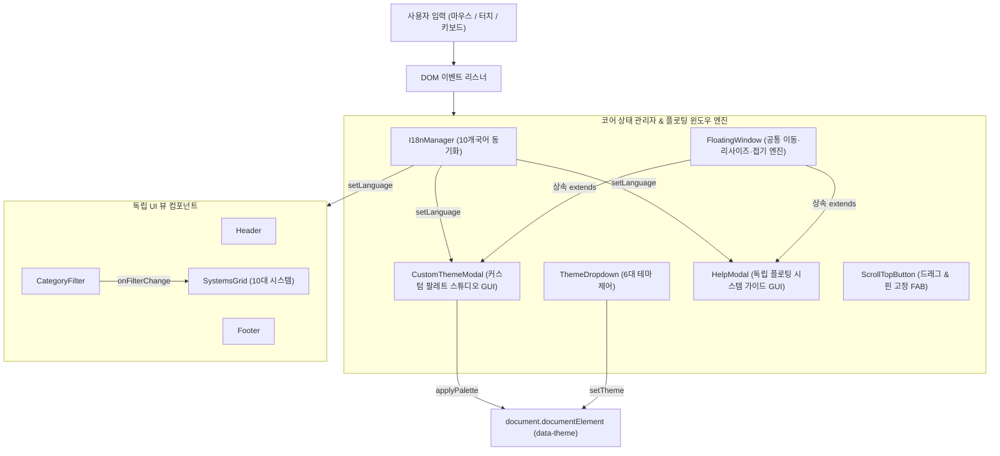
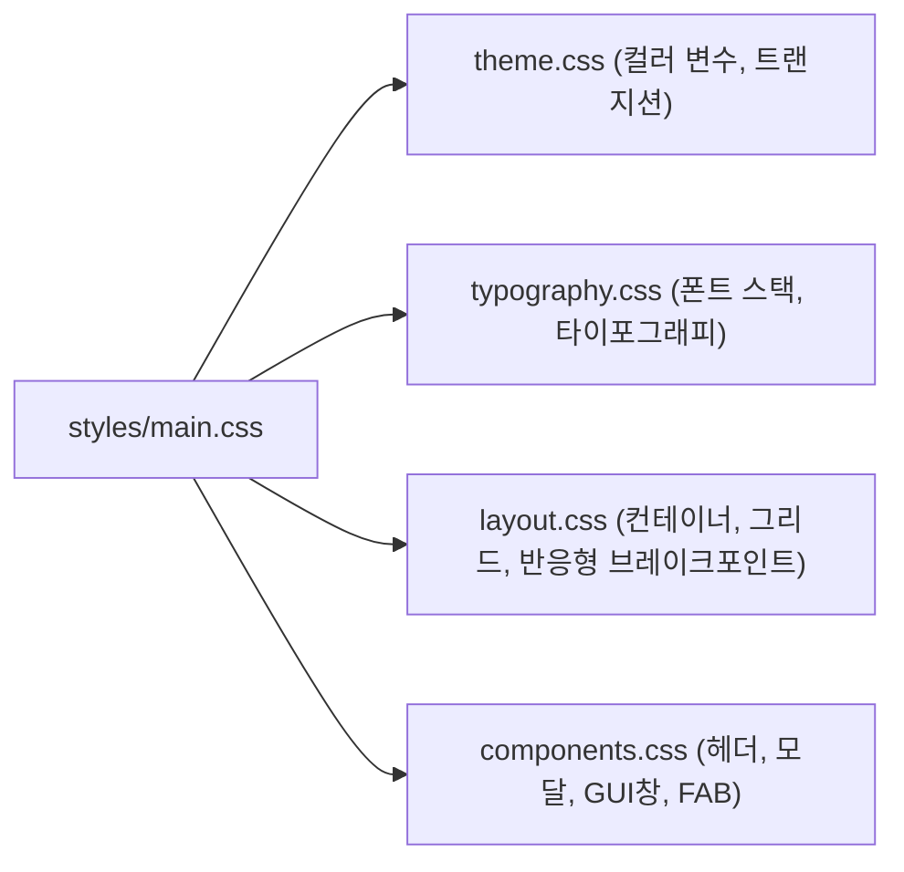

# KRC Labs Showcase — 아키텍처 매핑 (docs/ARCHITECTURE_MAP.md)

## 1. 컴포넌트 간 상호작용 및 데이터 흐름

## 2. 상태 저장소 영속성 매핑 (localStorage)

| 키(Key) | 기본값 | 설명 및 영속성 보장 정책 |
| :--- | :--- | :--- |
| `krc_lang` | `ko` | 선택된 언어 코드 (ko, en, ja, zh, de, fr, es, ru, hi, pt) |
| `krc_theme_pref` | `system` | 사용자 선호 테마 (dark, forest, sage, paper, custom, system) |
| `krc_custom_theme` | `{}` | 커스텀 테마 색상 팔레트 JSON (bg, surface, accent, textPrimary 등) |
| `krc_custom_win_pos`| `{}` | 커스텀 테마 플로팅 윈도우 좌표 및 크기 (left, top, width, height, collapsed) |
| `krc_help_win_pos`  | `{}` | 도움말 플로팅 윈도우 좌표 및 크기 (left, top, width, height, collapsed) |
| `krc_scroll_btn_pos`| `{}` | 맨 위로 FAB 플로팅 버튼의 화면 좌표 (left, top) |
| `krc_scroll_btn_pinned`| `false`| 맨 위로 FAB 버튼의 위치 고정 여부 (우클릭 / 롱프레스) |

## 3. 스타일 시스템 계층 구조

